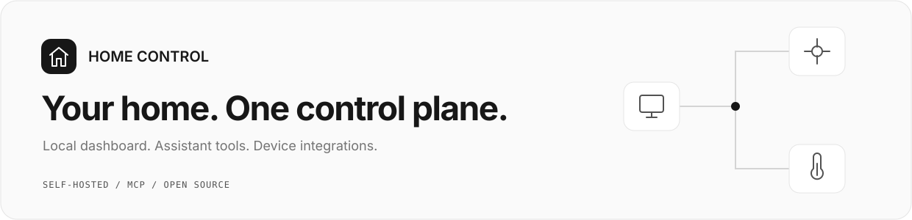
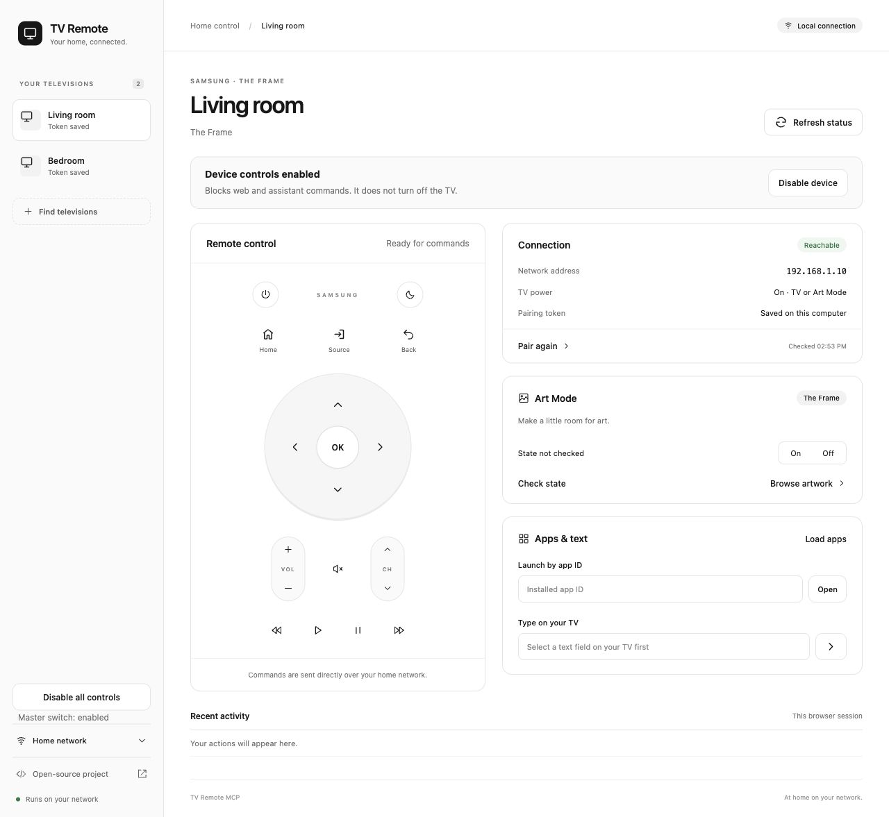

<p align="center">
  
</p>

Control your home devices from a web page or your coding assistant.
Run it on your laptop when you need it, or on a home computer that stays on.

<p align="center">
  <a href="https://github.com/joshsgoldstein/tv-remote-mcp/actions/workflows/ci.yml"></a>
  <a href="LICENSE"></a>
  <a href="docs/REFERENCE.md#requirements"></a>
  <a href="docs/DOCKER.md"></a>
</p>

## Let your coding agent set it up

Copy this prompt into your coding agent or agent harness.
It will help you choose where Home Control runs, install it, and connect your
assistant through MCP. Use the web page, assistant controls, or both.

```text
Set up https://github.com/joshsgoldstein/tv-remote-mcp for me.
Read AGENTS.md and docs/AGENT_SETUP.md first.
Ask where I want it to run and when it should be on.
Ask if I want the web page, assistant control, or both.
Explain the install options in simple words. Use answers I have already given.
Keep my saved settings and control switches. Keep the dashboard private.
Complete my chosen setup. Give me the web address and start and stop commands.
Leave TV pairing pending if I cannot select Allow on the TV.
Then help me set up my agent harness. Connect Home Control through MCP.
```

Your agent will ask a few questions, then guide you through setup.
You can run Home Control on your laptop when you need it, or on a home computer
that stays on.

<p align="center">
  
  <br><sub>Demo devices. Controls depend on your device.</sub>
</p>

## What you need

- A Linux or Mac computer on your home Wi-Fi.
- A supported TV. Samsung TVs and The Frame are supported first.
- Someone at the TV to select **Allow** for the first connection.

The computer must stay awake while you use the controls.
LG webOS and Sony BRAVIA adapters are experimental. Hardware checks are pending.

## Stay in control

Use **Disable device** to block one device.
Use **Disable all controls** to block all devices.
These switches also block assistant commands. They stay set after a restart.
Keep the dashboard private.

## Guides

| I want to... | Open this guide |
| --- | --- |
| Use my laptop only when I need it | [Laptop setup](docs/LAPTOP.md) |
| Install it myself | [Manual setup](docs/REFERENCE.md#quick-start) |
| Use Docker | [Docker setup](docs/DOCKER.md) |
| Understand how it works | [How it works](docs/HOW_IT_WORKS.md) |
| Connect my TV | [TV setup](docs/TV_VENDORS.md) |
| Add a device type | [Integrations](docs/INTEGRATIONS.md) |
| Set it up for someone | [Agent instructions](docs/AGENT_SETUP.md) |
| Help build it | [Contribute](CONTRIBUTING.md) |

Early release. Device discovery and status have been checked on hardware.
Remote buttons, apps, wake, and Art Mode still need checks after TV pairing.

[MIT license](LICENSE) · [Build checks](https://github.com/joshsgoldstein/tv-remote-mcp/actions) · [Technical reference](docs/REFERENCE.md)
