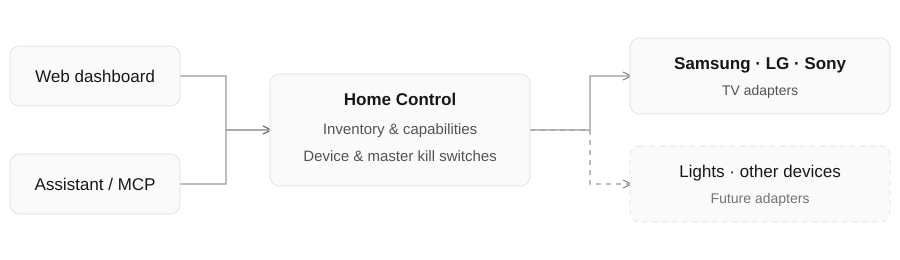

# How Home Control works

  

The dashboard and assistant use qualified IDs such as `samsung:frame`, discover
which capabilities a device offers, and route actions through its adapter.
The shared command gate checks the saved kill switches before adapter execution.
Each adapter owns its protocol, authentication, validation, and supported actions.

For Samsung, [samsungtvws](https://github.com/xchwarze/samsung-tv-ws-api) handles
local remote/Art Mode channels, with device information for discovery/status and
Wake-on-LAN for power-on. The [MCP Python SDK](https://github.com/modelcontextprotocol/python-sdk/tree/v1.x)
provides tool schemas and stdio transport. No public HTTP endpoint is required.

For adapter details, supported capabilities, and adding new device types, see
[the integration contract](INTEGRATIONS.md). For installation, return to the
[setup options](REFERENCE.md#quick-start).
